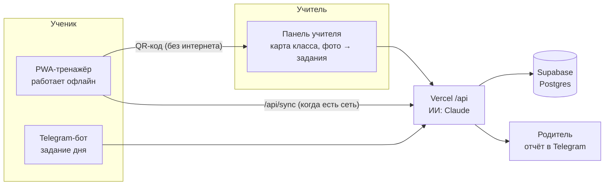

# Oqy: план на хакатон Órleu Hack 2026

> **Кейс 3. Образование: читать и понимать.**
> **Сдача онлайн-этапа: 27 ноября 2026, 23:00 (Астана). Наш внутренний дедлайн: 27 ноября, 21:00.**
> Финал: 29 ноября (5 минут защита + 3–5 минут вопросы).
>
> Рабочее название **Oqy** (каз. «оқы» — «читай»). Можно поменять, но до вечера 25-го.

**Как работать с этим файлом.** Это общий план. Каждый отмечает свои пункты `[x]` прямо здесь и коммитит. Менять контракты (раздел 6) можно только договорившись втроём.

| Часть | Кто | Зона ответственности |
|---|---|---|
| **A** | Нуржан | Приложение ученика (PWA): задания, подсказки, карта навыков, офлайн, QR-выгрузка |
| **B** | Искендер | Сервер, ИИ, база заданий, Telegram-бот |
| **C** | Капитан (владелец репозитория) | Панель учителя, дизайн, сборка и деплой, пилот с учениками, презентация, видео, сдача |

---

## 1. Проблема (для слайдов, всё с источниками)

- **36%** казахстанских 15-летних достигают базового уровня чтения по PISA-2025, в среднем по ОЭСР **69%**. По математике 44% против 65%. ([factcheck.kz](https://factcheck.kz/articles/pisa-2025-chto-proishodit-s-obrazovaniem-v-kazahstane), [OECD, country note](https://www.oecd.org/content/dam/oecd/ru/publications/reports/2026/09/pisa-2025-results-volume-i-country-notes_88d1164e/kazakhstan_3796da3b/7d50ea0b-ru.pdf))
- Причина не в доступе, а в практике: **73%** учеников заучивают формулы почти на каждом уроке (в Англии 24%). Анализ Всемирного банка: учителям не хватает навыка **составлять контекстные задания** на функциональную грамотность. ([factcheck.kz](https://factcheck.kz/articles/pisa-2025-chto-proishodit-s-obrazovaniem-v-kazahstane)) → **Отсюда наша функция «фото страницы → задания PISA».**
- Интернет есть в 99% школ, но нормальная скорость (от 20 Мбит/с) только в **92%**. Из 8 029 школ **2 832 сельские**. ([qumash.kz, 10.11.2026](https://qumash.kz/news/internet-est-pochti-vo-vseh-shkolah-kazahstana-no-skorost-ostavlyaet-voprosy/)) Дома у ребёнка в селе интернет ещё хуже, чем в школе.
- Государство запустило ИИ-пилот в **малокомплектных школах (их 2,6 тыс.)**: 10 школ с сентября 2026, 500 к маю 2027. ([dknews.kz](https://dknews.kz/ru/dk-it/403341-ii-prishel-v-selskie-shkoly-kazahstana-chto)) → Мы **не конкурент**, а инструмент, который работает там, где онлайн-платформа не тянет.

**Одной фразой для питча:** «Двое из трёх школьников не могут понять текст средней сложности. ChatGPT им не поможет: он даёт готовый ответ и не работает без интернета. Oqy учит думать, работает без сети и показывает учителю, какому ученику какой навык подтянуть».

---

## 2. Решение: одна система, три входа



### Чем мы отличаемся (это повторять на каждом слайде и в видео)

1. **Работает без интернета по-настоящему.** Задания, проверка и подсказки лежат в телефоне. Результаты ученик отдаёт учителю **QR-кодом**: учитель сканирует, интернет не нужен никому из них. На защите **выключаем Wi-Fi прямо на сцене**.
2. **Карта навыков PISA, а не «процент верных».** Три навыка из рамки PISA: *найти*, *понять*, *оценить*. Учитель видит: «Айгерим находит факты, но не делает выводы».
3. **ИИ не даёт ответ, а ведёт вопросами.** Лестница из 3 подсказок: от общего («перечитай 2-й абзац») к конкретному. Ответ не раскрывается никогда.
4. **Учитель фотографирует страницу учебника, и ИИ делает из неё задания в формате PISA** с ключами и подсказками. Учитель проверяет и раздаёт. Это решает проблему из отчёта Всемирного банка.
5. **«Уверен или угадал?»** Перед ответом ученик ставит уверенность. Учитель видит тех, кто **уверенно ошибается**: это ложные представления, их нужно разбирать первыми. Так почти никто не делает.
6. **Родитель получает человеческий отчёт в Telegram**, а не оценки: «хорошо находит факты, слабее делает выводы, спросите дома вот это».

---

## 3. Объём: что делаем, что нет (MoSCoW)

**MUST (без этого не сдаём):**
- Ученик: вход по коду класса и номеру, диагностика 9 заданий, тренировка, 3 формата заданий, лестница подсказок, карта навыков, офлайн, выгрузка результатов в QR.
- Учитель: создать класс, сканировать QR, карта класса (ученики × навыки), фото страницы → задания.
- ИИ: подсказки онлайн, проверка свободных ответов, генерация заданий по фото.
- База: 45 готовых заданий (15 на навык, 3 уровня сложности) с подсказками.
- Деплой на Vercel, работающая ссылка, презентация, видео 3 мин.

**SHOULD (если успеваем к 27-му, 15:00):**
- Telegram-бот: задание дня + недельный отчёт родителю.
- «Уверен или угадал?» и список «уверенно ошибается» у учителя.
- Формат «Задай вопрос сам».
- Учитель: «что делать завтра» (группы по слабому навыку), печать листа заданий (для детей без телефонов).
- Казахский язык для 9 заданий диагностики.

**COULD (только в презентации как «дорожная карта»):**
- Режим «класс без телефонов»: бумажные карточки-ответы, учитель сканирует весь класс одним телефоном.
- Функциональная математика («Выгодно или нет»: рассрочка, тарифы, урожай).
- Защита QR от подделки (подпись HMAC).

**НЕ делаем:** регистрацию с паролями для детей, чат с ИИ «спроси что угодно», нативное приложение, мультяшную геймификацию.

---

## 4. Форматы заданий

| Формат | Что делает ученик | Навык PISA | Проверка офлайн | Онлайн-бонус |
|---|---|---|---|---|
| **Классика PISA** | Короткий текст + вопрос с вариантами | найти / понять | Ключ | — |
| **Расследование** | 3–4 мини-документа (расписание, чек, сообщение, объявление). Нужно связать факты из разных документов | понять (интеграция) | Ключ | ИИ-подсказка по его ошибке |
| **Найди, где врут** | Текст «рассылки/новости». Отметить предложения с манипуляцией и выбрать тип: подмена фактов, эмоции вместо доказательств, ложный источник | оценить | Ключ по отмеченным предложениям | ИИ объясняет, почему это манипуляция |
| **Помоги семье** *(should)* | Документ (инструкция к лекарству, квитанция). Объяснить простыми словами | понять | Самопроверка по чек-листу | ИИ оценивает по рубрике |
| **Задай вопрос сам** *(should)* | Придумать вопрос к тексту | оценить | — | ИИ определяет уровень вопроса и даёт совет |

После верного ответа в 1 из 4 заданий спрашиваем **«Почему?»** одним предложением (онлайн, ИИ проверяет). Так отличаем знание от угадывания.

---

## 5. Стек (выбран, не обсуждаем)

| Слой | Технология | Почему |
|---|---|---|
| Фронтенд | React + Vite + TypeScript + Tailwind v4 | Быстро, все знают, одна кодовая база для ученика и учителя |
| Офлайн | `vite-plugin-pwa` (Workbox) + `dexie` (IndexedDB) | Кэш приложения и базы заданий, хранение попыток |
| QR | `qrcode` (генерация), `qr-scanner` (сканирование камерой), `pako` (сжатие) | Лёгкие, работают без сети |
| API | Vercel Functions (`/api/*.ts`), Node 20 | Деплой вместе с фронтом, бесплатно |
| База | Supabase (Postgres) | Бесплатно, панель для просмотра данных |
| ИИ | Claude API, SDK `@anthropic-ai/sdk` | Vision для фото учебника, структурированный JSON-ответ |
| Бот | `grammY` с webhook на Vercel | Один деплой, работает на слабой сети |
| Хостинг | `oqy.vercel.app` (или похожее) | Ссылка для жюри |

**Модели Claude.** По умолчанию `claude-opus-5-5` ($4 / $20 за 1 млн токенов). Одна подсказка ≈ 1 500 токенов на вход и 200 на выход ≈ **$0,01**. Генерация по фото ≈ **$0,05–0,10**. На хакатон хватит **$10–15**. **Решение команды (Искендер + капитан, до 26-го утра):** перевести подсказки и проверку на `claude-haiku-5-5` ($0,10 / $0,50, примерно в 40 раз дешевле) или оставить Opus. Генерацию по фото оставляем на Opus.

**Правила безопасности (обязательно):**
- Ключ `ANTHROPIC_API_KEY` только в переменных окружения Vercel. **Никогда** в коде, в репозитории и во фронтенде.
- В ИИ не отправляем имена детей. Ученик в системе — это `код класса + номер`.
- Системный промпт подсказок запрещает раскрывать ответ. Сервер дополнительно проверяет: если в тексте подсказки есть правильный ответ, отдаём статическую подсказку из базы.
- Пользователи 13–15 лет: промпты в спокойном учебном тоне, ИИ отвечает только по заданию, на посторонние темы вежливо возвращает к тексту.

---

## 6. Контракты (замораживаем 25-го вечером, дальше только по договорённости)

Файл `shared/types.ts`. Его импортируют и фронт (A, C), и сервер (B).

```ts
export type Skill = 'locate' | 'understand' | 'evaluate';   // найти / понять / оценить
export type Format = 'classic' | 'investigation' | 'fake' | 'family' | 'ask';
export type Lang = 'ru' | 'kk';

export interface Task {
  id: string;                 // "c-loc-01", "inv-03", "photo-<uuid>"
  format: Format;
  skill: Skill;
  difficulty: 1 | 2 | 3;
  lang: Lang;
  title: string;
  docs: { title: string; body: string }[];      // 1 текст или несколько документов
  question: string;
  answer:
    | { type: 'choice'; options: string[]; correct: number }
    | { type: 'multi'; options: string[]; correct: number[] }
    | { type: 'spans'; sentences: string[]; correct: number[] }   // «Найди, где врут»
    | { type: 'free'; rubric: string[] };                         // онлайн-проверка ИИ
  hints: [string, string, string];   // лестница: общая → конкретная, без ответа
  explanation: string;               // показываем ПОСЛЕ ответа
  source?: 'pack' | 'photo' | 'ai';
}

export interface Attempt {
  taskId: string;
  score: 0 | 0.5 | 1;
  hintsUsed: 0 | 1 | 2 | 3;
  confidence?: 1 | 2 | 3;    // 1 угадываю, 3 уверен
  answer?: string;           // только для free/ask, на сервер
  ts: number;                // unix, секунды
}

export interface Student { classCode: string; number: number; }   // без имён

export interface SkillState { skill: Skill; rating: number; attempts: number; }
```

### Модель навыков (Elo, считается и в приложении, и на сервере одинаково)

```
ожидание  E = 1 / (1 + 10^((D − R) / 400)),   D = 1100 / 1250 / 1400 для сложности 1/2/3
результат S = score × (1 − 0.2 × hintsUsed)
новый     R = R + 32 × (S − E),   старт R = 1200
уровень   1…5 = границы 1050 / 1150 / 1250 / 1350
```
На экране пишем «уровень навыка», **не** «уровень PISA» (мы не PISA и не обещаем этого жюри).

### QR-протокол

```
Ученик → учитель:   OQ1|<classCode>|<number>|<part>/<total>|<base64url(deflate(JSON))>
JSON = [[taskIdx, score*2, hintsUsed, confidence, tsMinutes], ...]   // taskIdx = индекс в pack-v1
Учитель → ученик:   OQA|<classCode>|<taskId,taskId,...>                 // задание на дом
```
- Один QR не больше **800 байт** (стабильно читается камерой телефона). Больше: несколько частей, приложение листает их само каждые 1,5 с.
- В конце JSON добавляем CRC32. Если не сошлось, сканер просит повторить.
- Запасной путь: учитель вводит короткий код вручную (если камера не читает).

### API (часть B делает, A и C вызывают)

| Метод | Вход | Выход | Офлайн-замена |
|---|---|---|---|
| `GET /api/pack?v=1` | — | `Task[]` | Кэш PWA |
| `POST /api/hint` | `{taskId, answer, hintLevel}` | `{hint}` | `task.hints[hintLevel]` |
| `POST /api/grade` | `{taskId, answer}` | `{score, feedback}` | Самопроверка |
| `POST /api/why` | `{taskId, reason}` | `{ok, feedback}` | Пропускаем |
| `POST /api/photo-tasks` | `{imageBase64, grade, lang}` | `Task[]` (3–6 шт.) | Нет (только онлайн) |
| `POST /api/sync` | `{student, attempts[]}` | `{skills: SkillState[]}` | QR |
| `POST /api/class` | `{name}` | `{classCode, teacherKey}` | — |
| `GET /api/class/:code` | заголовок `x-teacher-key` | ученики, навыки, попытки | Локальные данные учителя |
| `POST /api/bot` | Telegram webhook | — | — |

### База (Supabase)

```
classes(code pk, name, teacher_key_hash, created_at)
students(class_code fk, number, tg_chat_id, parent_chat_id, pk(class_code, number))
tasks(id pk, format, skill, difficulty, lang, payload jsonb, source, class_code null)
attempts(id, class_code, number, task_id, score, hints_used, confidence, answer, ts, via: 'online'|'qr'|'bot')
skill_state(class_code, number, skill, rating, attempts, pk(class_code, number, skill))
```

---

## 7. Структура репозитория

```
/app            ← PWA (A: student/*, C: teacher/*, общие ui/*)
  src/student/  ← A
  src/teacher/  ← C
  src/ui/       ← C (дизайн-система: цвета, шрифты, кнопки)
  src/lib/      ← A: elo.ts, qr.ts, db.ts (dexie)
/api            ← B: Vercel Functions
/content        ← B: pack-v1.json, промпты prompts/*.md
/shared         ← types.ts (меняем только втроём)
/docs           ← C: презентация, сценарий видео, результаты пилота
PLAN.md         ← этот файл
```

---

## 8. Задачи по частям

### Часть A — Нуржан: приложение ученика

**25 ноября (вечер)**
- [x] Скелет `app/` на Vite + React + TS + Tailwind (или забрать у C, если он уже создал)
- [x] `vite-plugin-pwa`: приложение открывается без сети после первого захода
- [x] `dexie`: таблицы `attempts`, `skills`, `pack`

**26 ноября**
- [x] Вход: код класса + номер ученика (без пароля), хранится локально
- [x] Плеер заданий: `classic` и `investigation` (несколько документов вкладками)
- [x] Плеер `fake`: тап по предложениям + выбор типа манипуляции
- [x] Лестница подсказок: кнопка «Подсказка» → 1, 2, 3; онлайн берём `/api/hint`, офлайн `task.hints`
- [x] `lib/elo.ts` по формулам из раздела 6, юнит-тест на 3 случая
- [x] Диагностика: 9 заданий (3 на навык) → первая карта навыков
- [x] Выбор следующего задания: самый слабый навык, сложность ближе к рейтингу
- [x] Экран «Карта навыков»: 3 шкалы, уровни 1–5, что тренировать дальше

**27 ноября (до 15:00)**
- [x] `lib/qr.ts`: упаковка попыток в QR по протоколу, разбиение на части, CRC32
- [x] Экран «Отдать учителю» (QR во весь экран, яркость, листание частей)
- [x] Синхронизация `/api/sync`, когда сеть появилась (очередь в dexie)
- [x] *(should)* Ползунок уверенности перед ответом
- [x] *(should)* Вопрос «Почему?» после верного ответа (онлайн)
- [ ] Проверка: режим самолёта → пройти 5 заданий → выгрузить QR (в браузере без сервера пройдена, осталось на телефоне)

**Готово, когда:** на телефоне в режиме самолёта ученик проходит диагностику и тренировку, видит карту навыков и показывает QR.

### Часть B — Искендер: сервер, ИИ, контент, бот

**25 ноября (вечер)**
- [ ] Аккаунт Supabase, таблицы из раздела 6, ключи в Vercel
- [ ] Аккаунт Anthropic Console, пополнить на $10–15, ключ **только** в Vercel env
- [ ] `shared/types.ts` (вместе со всеми, 30 минут созвон)

**26 ноября**
- [ ] `content/pack-v1.json`: 45 заданий (15 на навык × 3 сложности). Черновик генерируем ИИ, **каждое задание вычитываем глазами** (черновик готов, осталось вычитать)
- [x] Для каждого задания 3 подсказки без ответа + объяснение
- [x] `POST /api/hint`: промпт «сократический репетитор», проверка «ответ не раскрыт», запасная статическая подсказка
- [x] `POST /api/grade` и `/api/why`: структурированный JSON `{score, feedback}`
- [x] `POST /api/photo-tasks`: картинка → 3–6 `Task` в формате из раздела 6 (structured output), `maxDuration` 60 с
- [x] `POST /api/sync`, `/api/class`, `GET /api/class/:code`
- [x] Промпты в `content/prompts/*.md`, чтобы их было видно жюри

**27 ноября (до 15:00)**
- [x] *(should)* Бот `grammY`: `/start <код>-<номер>`, задание дня с кнопками A–D, результат в ту же базу
- [x] *(should)* Привязка родителя: `/parent <код>-<номер>`, недельный отчёт простым языком (ИИ по `skill_state`)
- [x] *(should)* 9 заданий диагностики на казахском (вычитать носителю)
- [x] Тест на сбои: нет ключа, таймаут ИИ, кривая картинка. Везде понятная ошибка, приложение не падает

**Готово, когда:** все эндпоинты отвечают на продакшен-ссылке, база заданий загружается, фото страницы учебника превращается в задания меньше чем за 30 с.

### Часть C — капитан: учитель, дизайн, сборка, питч

**25 ноября (вечер)**
- [ ] Создать монорепо по разделу 7 ✅, Vercel-проект (конфиг `vercel.json` готов, осталось импортировать проект: `docs/deploy.md`), автодеплой из `main`
- [ ] Добавить Нуржана и Искендера в репозиторий (collaborators)
- [x] Дизайн-система в `src/ui/` через скилл `ui-ux-pro-max`: 1 акцентный цвет, шрифт с кириллицей и казахскими буквами (Inter или Manrope), крупный текст для чтения (18px+). Без фиолетовых градиентов
- [ ] Договориться с 7–9-классниками на пилот 26–27 ноября (5–10 человек: братья, сёстры, своя школа) + согласие родителей на фото

**26 ноября**
- [x] Учитель: создать класс → код класса + ключ учителя
- [x] Сканер QR (`qr-scanner`): склейка частей, проверка CRC, сохранение попыток, ручной ввод кода
- [x] Карта класса: таблица ученики × 3 навыка, цвет по уровню, клик → история ученика
- [x] Фото → задания: снять или загрузить → превью → правка текста → «Раздать классу»
- [x] Выдача задания: QR `OQA|…` на экран класса или ссылка

**27 ноября**
- [x] *(should)* «Уверенно ошибается»: список учеников и заданий
- [x] *(should)* «Что делать завтра»: группы по слабому навыку
- [x] *(should)* Печать листа заданий (CSS print)
- [ ] Пилот: диагностика → 15 минут тренировки → 3 вопроса ученику, 1 цитата учителя. Записать цифры
- [ ] До 15:00 заморозка функций; 15:00–19:00 только баги (скилл `web-design-guidelines` для аудита интерфейса)
- [ ] 19:00–21:00 видео + презентация; **21:00 отправить форму**

**Готово, когда:** ссылка работает у жюри с телефона и компьютера, видео ≤ 3:00, презентация ≤ 10 слайдов, форма отправлена.

---

## 9. График и точки синхронизации

| Когда | Что | Кто |
|---|---|---|
| **25.11, 20:00** | Созвон 30 мин: утвердить имя, стек, `shared/types.ts`, кто что делает | все |
| 25.11, 23:00 | Скелет задеплоен, ссылка открывается | C |
| **26.11, 14:00** | Точка 1: ученик проходит 1 задание из базы B | A + B |
| **26.11, 21:00** | Точка 2: QR от ученика читается у учителя; фото → задания работает | все |
| 27.11, 12:00 | Пилот с учениками | C (+ кто свободен) |
| **27.11, 15:00** | **Заморозка функций.** Дальше только исправления | все |
| 27.11, 19:00 | Скриншоты, запись видео | C |
| **27.11, 21:00** | **Отправка формы** (2 часа запаса) | C |
| 28.11, до 20:00 | Итоги отбора, вопросы в Telegram организаторам | C |
| 28.11 | Если финал: полировка, репетиция защиты 3 раза | все |

Подстройте под уроки: если кто-то в школе днём, его задачи сдвигаются на вечер, **точки синхронизации не двигаем**.

---

## 10. Правила Git (чтобы не сломать друг другу работу)

1. Не пушим напрямую в `main`. Ветки `a/<что-делаю>`, `b/...`, `c/...` → Pull Request → C сливает.
2. Перед началом работы `git pull origin main`.
3. Коммитим маленькими кусками, понятное сообщение: `A: плеер расследований`.
4. `shared/types.ts` меняем только после сообщения в общем чате.
5. Никогда не коммитим `.env`, ключи, фото детей.
6. Сломали `main` — чиним в первую очередь, всё остальное ждёт.

---

## 11. Сдача: что именно отправляем

- [ ] **Описание** (150–200 слов): проблема, решение, 3 отличия
- [ ] **Ссылка на прототип** (`*.vercel.app`) + тестовый класс с кодом для жюри: `DEMO` и ключ учителя в описании
- [ ] **Ссылка на код** (этот репозиторий, публичный, README с запуском)
- [ ] **Презентация ≤ 10 слайдов** (PDF)
- [ ] **Питч-видео ≤ 3 минут**
- [ ] В презентации **список ИИ-инструментов** (требование положения, п. 6.3): Claude Code, Claude API, скиллы дизайна

### Презентация (10 слайдов → критерии жюри)

| # | Слайд | Критерий (баллы) |
|---|---|---|
| 1 | Название, одна фраза, команда | — |
| 2 | Проблема: 36% против 69%, заучивание, учителям не хватает контекстных заданий | Понимание проблемы (20) |
| 3 | Кто пользователь: Айгерим, 8 класс, село; учитель Сауле; мама | Понимание проблемы |
| 4 | Решение: одна система, три входа (схема) | Решение (25) |
| 5 | Офлайн + QR: как это работает (3 шага, картинки) | Решение / Техника |
| 6 | ИИ: подсказки без ответа, фото → задания, карта навыков | Решение / Техника (25) |
| 7 | Архитектура и стек, что ИИ делает и чего не делает | Техника |
| 8 | **Пилот: реальные цифры с учениками** | Польза (15) |
| 9 | Масштаб: 2 832 сельские школы, 2,6 тыс. малокомплектных, связь с госпилотом; бесплатно для учеников | Польза и масштаб |
| 10 | Дорожная карта + ИИ-инструменты, которые использовали | Презентация (15) |

### Видео 3:00 (сценарий)

| Время | Кадр | Текст |
|---|---|---|
| 0:00–0:20 | Цифра 36% на экране | «Двое из трёх школьников не понимают текст средней сложности» |
| 0:20–0:40 | Сельская школа, слабая сеть | «А ИИ-помощники требуют интернета и выдают готовые ответы» |
| 0:40–1:30 | Телефон в **режиме самолёта**: диагностика, ошибка, лестница подсказок, карта навыков | «Oqy работает без сети и учит думать, а не списывать» |
| 1:30–2:00 | QR → телефон учителя → карта класса | «Учитель видит, кому какой навык подтянуть» |
| 2:00–2:30 | Фото страницы учебника → задания PISA | «Любая страница становится заданием за 20 секунд» |
| 2:30–2:50 | Цифры пилота, бот родителю | «Мы проверили на N учениках…» |
| 2:50–3:00 | Логотип, ссылка | «Oqy. Читай и понимай» |

---

## 12. Пилот с учениками (наш главный козырь для жюри)

Почти никто из команд не принесёт данные с настоящими детьми. Мы принесём.

- 5–10 учеников 7–9 класса, 30 минут, с согласия родителей.
- Порядок: диагностика (9 заданий) → 15 минут тренировки → 3 вопроса: «понятно ли было?», «помогли ли подсказки?», «стал бы пользоваться?» (1–5).
- Записываем: сколько заданий сделали, доля заданий, решённых **с подсказкой без раскрытия ответа**, оценки 1–5, 1–2 цитаты.
- **Честно:** за 30 минут рост навыка не измерить. Говорим о вовлечённости и понятности, рост показываем как план следующего пилота.
- Если удастся: 1 настоящий учитель пробует «фото → задания» и даёт цитату.

---

## 13. Риски и запасные планы

| Риск | Что делаем |
|---|---|
| Нет оплаты или ключа ИИ | Приложение работает на базе заданий и статических подсказках. Демо не ломается |
| ИИ отвечает долго на фото | `maxDuration: 60`, индикатор прогресса, заранее заготовленный пример на защиту |
| Камера не читает QR | Ручной ввод короткого кода; QR не больше 800 байт |
| Задания с ошибками | Каждое вычитывается человеком; ИИ-задания учитель проверяет перед раздачей |
| Не успеваем бота | Это SHOULD. Показываем в дорожной карте, ядро важнее |
| Сломался `main` перед сдачей | Заморозка в 15:00, сдаём в 21:00, у нас 2 часа запаса |
| Падает связь на онлайн-финале | Заранее записанное демо-видео + повторная попытка по правилам (п. 7.3) |

---

## 14. Вопросы жюри: готовые ответы

- **«Чем вы лучше ChatGPT?»** ChatGPT даёт готовый ответ и требует интернет. У нас ответ не раскрывается, работает офлайн, учитель видит навыки класса.
- **«Чем вы отличаетесь от национальной ИИ-платформы?»** Мы её дополняем: узкий фокус на функциональной грамотности по рамке PISA и офлайн-режим для слабой сети.
- **«А если ИИ ошибётся?»** Офлайн-база вычитана людьми. ИИ-задания учитель проверяет перед раздачей. Подсказки фильтруются, чтобы не выдать ответ.
- **«Как защищены данные детей?»** Нет имён и паролей, только код класса и номер. В ИИ уходит только текст ответа.
- **«Как это работает без интернета?»** Приложение и задания хранятся в телефоне, результаты передаются QR-кодом. Показываем вживую в режиме самолёта.
- **«Кто будет платить?»** Ученикам бесплатно. Платят школы и акиматы за аналитику учителя. Партнёрство с образовательными центрами (например, спонсоры хакатона) для контента.
- **«Почему вы верите, что это поможет?»** PISA меряет именно эти три навыка. Мы тренируем их напрямую и даём учителю то, чего ему не хватает по оценке Всемирного банка: готовые контекстные задания.

---

## 15. Чек-лист перед отправкой (27.11, 20:30)

- [ ] Ссылка открывается с чужого телефона, в режиме инкогнито
- [ ] Режим самолёта: тренировка работает
- [ ] QR читается с другого телефона
- [ ] Фото → задания работает на продакшене
- [ ] В репозитории нет ключей (`git grep -i "sk-ant"` пусто)
- [ ] README: что это, ссылка, как запустить, демо-класс
- [ ] Видео ≤ 3:00, звук слышно
- [ ] Презентация ≤ 10 слайдов, есть слайд с ИИ-инструментами
- [ ] Форма отправлена, скриншот подтверждения в общий чат
